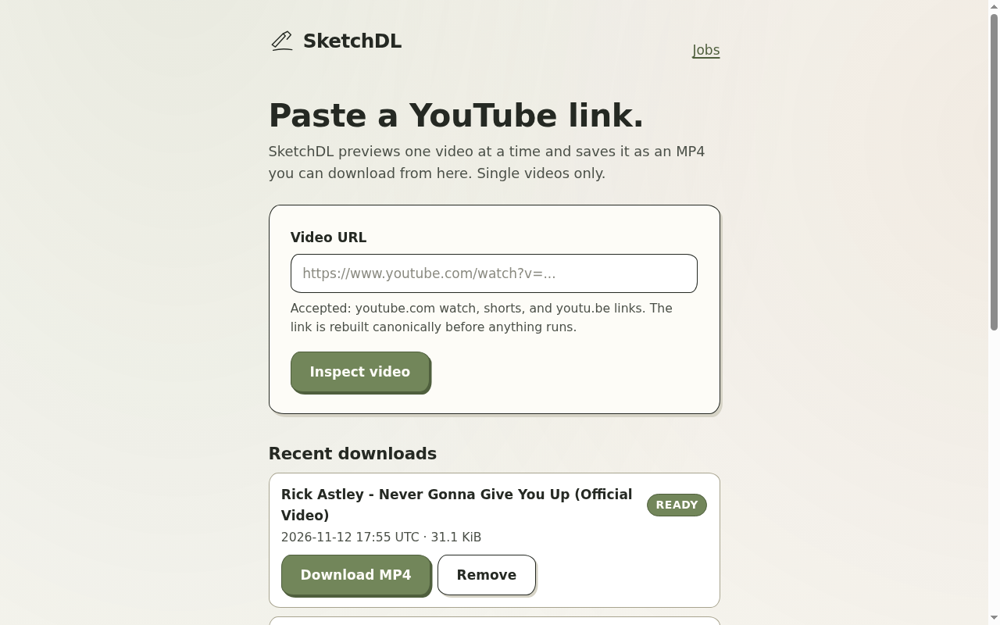
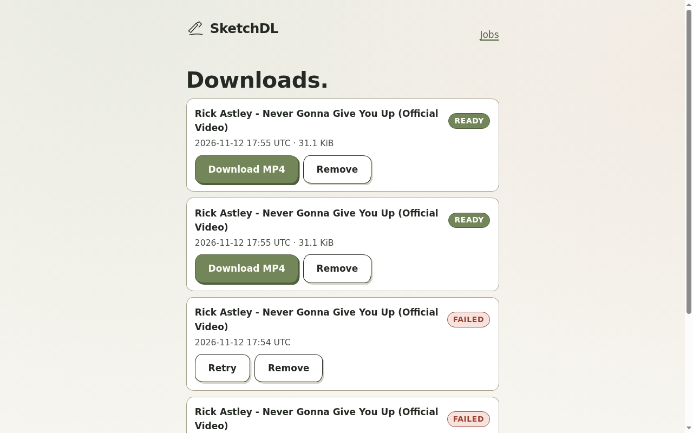

# SketchDL (Rust + Axum)

**A pencil-on-paper YouTube MP4 downloader: one owner, server-rendered
HTML, real progress over SSE, no frontend framework.**

[](https://www.rust-lang.org/)
[](https://github.com/tokio-rs/axum)




SketchDL is a private, single-owner downloader that runs on a cheap VPS.
Paste one YouTube link, get a preview of what is actually available,
pick a quality, and the video lands on disk as a verified H.264/AAC MP4
you can fetch back over HTTP with range requests.

The whole server is Rust: Axum + Tokio for HTTP, `rusqlite` for SQLite,
Argon2id for auth, `tokio::process` for yt-dlp/ffprobe. The UI is
server-rendered HTML with one stylesheet and a 2.8 KB script loaded only
on an active job page. That script consumes a Server-Sent Events stream;
without it the same page still refreshes every 3 seconds. There is no
WASM bundle, no client router, no build step for the frontend.

There is no registration, no multi-user anything, no cookies for bypass,
no playlists, no DRM: one fixed `yt-dlp` invocation, canonical URL
rebuild, and an ffprobe check before anything is called READY.

| | |
|---|---|
| Runtime | Rust 1.99, one process, Tokio tasks per download |
| HTTP | Axum 0.8, HTTP/1.1 keep-alive |
| Storage | SQLite 3.54 (bundled), one file, rollback journal (`DELETE`) |
| UI | Server-rendered HTML, one CSS file, hand-drawn SVG |
| Live progress | SSE (`/jobs/<id>/events`), 200 ms push, DB writes throttled |
| JavaScript | 2.8 KB on active job pages only; every page works without it |
| Downloads | yt-dlp metadata + download, fixed argv, no shell, own process group |
| Verify | ffprobe: H.264 video + AAC audio in MP4 before READY |
| Auth | one owner, Argon2id, server-side sessions, CSRF, login limiter |
| Public port | never. SketchDL binds loopback and sits behind a TLS proxy |

## Measured speed

Loopback, release build, 300 requests over keep-alive connections, no
TLS proxy in the path:

| request | p50 | p95 |
|---|---:|---:|
| `GET /` (authenticated, 8 recent jobs) | 2.23 ms | 3.99 ms |
| `GET /jobs` | 1.67 ms | 3.20 ms |
| `GET /assets/style.css` | 0.85 ms | 1.36 ms |
| `GET /`, new TCP connection each time | 3.05 ms | 6.51 ms |

Idle RSS in the integration run is ~6 MiB. Server work is far below the
30 ms target; a real video download still takes as long as YouTube and
the network take. The app adds no polling delay: a job starts as soon as
it is enqueued, and progress lines are pushed as they arrive.

## A quick tour

### Paste a link, get a preview

The home page takes one link. Strict validation accepts only
`youtube.com` watch/shorts and `youtu.be` URLs, extracts the 11-character
video id, and rebuilds the canonical URL — nothing raw ever reaches a
process. yt-dlp runs metadata-only (`--dump-single-json`, capped, with a
deadline), and the preview lists only formats that are actually H.264/AAC
MP4 compatible, grouped by preset.


### Jobs with a real progress bar

Enqueueing creates a durable job row (`QUEUED` → `DOWNLOADING` →
`VERIFYING` → `READY`, or `FAILED` with a structured code). Progress,
bytes, speed, and ETA come from yt-dlp's progress output. The job page
subscribes to SSE and updates a native `<progress>` element, byte counts,
speed, and ETA in place. Video and audio components are aggregated by
format id, so a `134+140` download does not reset the bar when the audio
stream starts. The database is written at most twice a second, not once
per line.


### History like a ruled notebook page

Every job stays listed with its state, size, and dates until the TTL
sweeps it. Cancel, retry, and remove are ordinary POST forms.



## Layout

| path | role |
|---|---|
| `server/src/main.rs` | CLI, admin commands, runtime startup |
| `server/src/web.rs` | Axum router, auth guards, SSE, range downloads |
| `server/src/jobs.rs` | yt-dlp inspect/download, progress aggregation, publish |
| `server/src/db.rs` | SQLite connection, migrations, jobs/sessions/inspections |
| `server/src/auth.rs` | Argon2id, sessions, CSRF, login limiter |
| `server/src/input.rs` | strict YouTube URL validation, canonical rebuild |
| `server/src/ytdlp.rs` | format allowlist, argv/template constants, progress parsing |
| `server/src/media.rs` | ffprobe MP4 compatibility verification |
| `server/src/proc.rs` | async child capture, process groups, deadlines, tails |
| `server/src/views.rs` | HTML views and SSE payload |
| `server/src/state.rs` | shared state, event bus, cancellation, disk check |
| `web/style.css` | the paper-and-pencil theme |
| `web/progress.js` | 2.8 KB SSE progress script (active jobs only) |
| `migrations/0001_init.sql` | schema |
| `tests/integration.py` | 85-check end-to-end suite (real server, mock yt-dlp) |
| `scripts/bench.py` | RSS/PSS, latency, page weight |
| `deploy/` | nginx and systemd units |
| `docs/` | design, security, operations notes |

## Build

Requires Rust (edition 2024; tested with 1.99) and a C compiler for the
bundled SQLite. No Goose compiler, no Node, no WASM toolchain.

```sh
make build   # cargo build --release, copies ./sketchdl
make check   # cargo check
make tools   # fetch yt-dlp, static ffmpeg/ffprobe, deno, EJS + bgutil POT provider
```

A cold release build is a few minutes; incremental builds are seconds.
The release profile uses thin LTO, one codegen unit, and strips symbols.

## Test

```sh
make test    # tests/integration.py (85 checks)
python3 scripts/bench.py --binary ./sketchdl   # RSS/PSS, latency, weight
```

The suite runs a real server against a mock yt-dlp that emits a real
H.264/AAC MP4. It covers login/CSRF/limiter, URL validation, inspect,
format selection, job actions, SSE progress persistence, byte-range
downloads, command-injection rejection, and SIGKILL recovery. There is
also a verified end-to-end path with the real yt-dlp (inspect → preview
→ download → ffprobe-confirmed file).

## Run

```sh
printf 'correct horse battery staple\n' | ./sketchdl admin set-password --db data/sketchdl.db
./sketchdl serve --db data/sketchdl.db --data data --listen 127.0.0.1:8087 \
  --ytdlp tools/yt-dlp --ffmpeg tools/ffmpeg/bin/ffmpeg \
  --ffprobe tools/ffmpeg/bin/ffprobe --deno tools/deno --ejs-parent tools/ejs \
  --bgutil-home tools/bgutil-ytdlp-pot-provider/server --min-free-bytes 0
```

`--concurrent-fragments N` (1–16, default 4) is passed to yt-dlp for
fragmented formats. `--max-active N` (default 5) bounds concurrent jobs
without a supervisor poll. See `deploy/` for the nginx + systemd setup
and `docs/` for design and operations notes.

## Implementation notes

Things worth knowing before you touch the code:

- **Why raw HTML instead of WASM.** A WASM frontend cannot beat a
  server-rendered page for a form-and-progress UI, and it would add a
  multi-hundred-KB download plus JS glue before the first paint. Axum
  renders the page in ~2 ms; the only client code is the SSE script.
- **Progress template.** `--progress-template` takes
  `"<type>:<template>"`; the `<type>:` is consumed by yt-dlp's option
  parser and never printed. The literal marker therefore sits inside the
  template body (`download:skdl-progress|...`). The mock renders the
  template instead of hard-coding a line shape, so a template/parser
  mismatch fails the suite.
- **Process groups.** Each yt-dlp child calls `setsid()` before `exec`.
  Cancellation and timeouts do `kill(-pid, SIGKILL)`, which also stops
  ffmpeg and Deno descendants. `kill_on_drop` is a second line of
  defence.
- **Recovery.** Workers are Tokio tasks in the server process. On
  startup, jobs left in `DOWNLOADING`/`VERIFYING` have their old child
  process group killed, are requeued (up to 3 attempts), and are spawned
  again. A SIGKILLed server cannot leave an orphan writing to a job it
  no longer owns.
- **No shell.** Every subprocess uses a structured argv vector, and the
  only URL passed is the canonical URL rebuilt from a validated
  11-character id. User input never reaches a command line.
- **Downloads.** Files are streamed with `tokio::fs` + `ReaderStream`,
  not read into memory. `Range`, suffix ranges, `ETag`, and
  `If-None-Match` are handled directly; invalid ranges return `416`.
- **SQLite.** One connection behind a mutex, `busy_timeout=5000`,
  `synchronous=FULL`, rollback journal. Writes are short; page reads are
  microseconds. Backups use `VACUUM INTO`.
- **Sessions.** Cookie value is a random 32-byte token; SQLite stores
  only its SHA-256. CSRF token is separate, per session, and compared in
  constant time. Cookies are `HttpOnly; SameSite=Lax; Secure` unless
  `--insecure-cookies` is passed for local HTTP.
