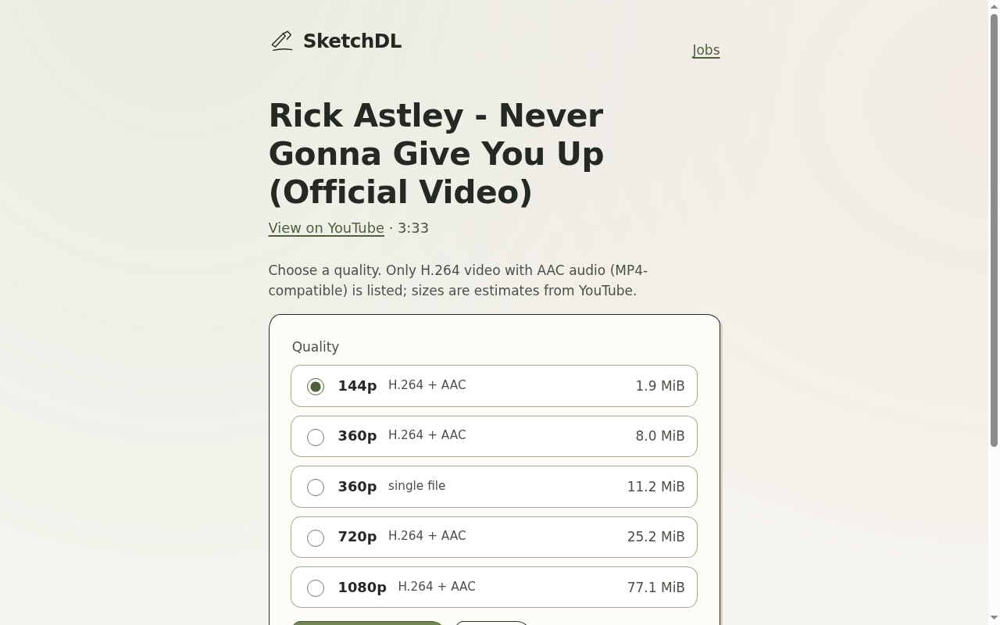
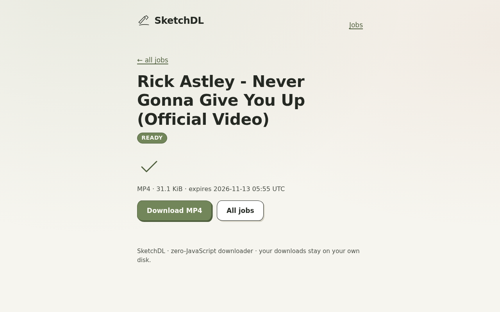

# SketchDL (Goose)

**A pencil-on-paper YouTube MP4 downloader: one owner, one video at a
time, zero JavaScript.**

[](https://github.com/aardappel/goose)


SketchDL is a private, single-owner downloader that runs on a cheap VPS.
Paste one YouTube link, get a preview of what is actually available,
pick a quality, and the video lands on disk as a verified H.264/AAC MP4
you can fetch back over HTTP with range requests. It is built in
[Goose](https://github.com/aardappel/goose) — the app, the HTTP server,
the auth, and the SQLite layer are all Goose, with C only through interop
where justified (SQLite, POSIX processes). There is no registration, no
multi-user anything, no cookies for bypass, no playlists, no DRM: one
fixed `yt-dlp` invocation, canonical URL rebuild, and an ffprobe check
before anything is called READY.

It is meant for the case where you want your videos on your own disk,
you want one database file for backups, and you want the whole thing to
run with JavaScript disabled — because there is none.

| | |
|---|---|
| Runtime | Goose, one process, worker children per download |
| Storage | SQLite 3.54.1, one file, rollback journal (`DELETE`) |
| UI | Server-rendered HTML, one CSS file, hand-drawn SVG |
| JavaScript | none, ever |
| Downloads | yt-dlp metadata + download, fixed argv, no shell |
| Verify | ffprobe: H.264 video + AAC audio in MP4 before READY |
| Auth | one owner, Argon2id, server-side sessions |
| Public port | never. SketchDL binds loopback and sits behind a TLS proxy |

## A quick tour

### Paste a link, get a preview

The home page takes one link. Strict validation accepts only
`youtube.com` watch/shorts and `youtu.be` URLs, extracts the 11-character
video id, and rebuilds the canonical URL — nothing raw ever reaches a
process. yt-dlp runs metadata-only (`--dump-single-json`, capped, with a
deadline), and the preview lists only formats that are actually H.264/AAC
MP4 compatible, grouped by preset.



### One job at a time, honestly reported

Enqueueing creates a durable job row (`QUEUED` → `DOWNLOADING` →
`VERIFYING` → `READY`, or `FAILED` with a structured code). Progress,
bytes, speed, and ETA come from yt-dlp's progress output into SQLite
about once a second. A worker child runs the download; the server
requeues anything interrupted by a restart, and `SIGKILL` recovery is a
tested path, not a hope.



### History like a ruled notebook page

Every job stays listed with its state, size, and dates until the TTL
sweeps it. Cancel, retry, and remove are ordinary POST forms.


## Layout

| file | role |
|---|---|
| `sketchdl.goose` | HTTP server, router, handlers, supervisor, worker-once |
| `db.goose` | SQLite bindings, migrations, jobs/sessions/inspections |
| `auth.goose` | Argon2id, sessions, CSRF, login limiter |
| `crypto.goose` | SHA-256, hex, `getrandom` (pure Goose) |
| `input.goose` | strict YouTube URL validation, canonical rebuild |
| `ytdlp.goose` | inspect/download argv, error classification, progress parse |
| `media.goose` | ffprobe MP4 compatibility verification |
| `proc.goose`, `net.goose`, `storage.goose`, `util.goose` | subprocess, sockets, file storage, helpers |
| `views.goose` | HTML templates (zero JS) |
| `web/style.css` | the paper-and-pencil theme |
| `vendor/proc.c` | fork/setsid/pipe/poll interop (children close inherited fds) |
| `vendor/sqlite/` | the SQLite amalgamation (3.54.1) |
| `migrations/0001_init.sql` | schema |
| `tests/integration.py` | 74-check end-to-end suite (real server, mock yt-dlp) |
| `scripts/bench.py` | real measurements: RSS/PSS, latency, page weight |
| `deploy/` | nginx and systemd units |

All application logic is Goose. C appears only through interop where
justified: SQLite, POSIX sockets/processes, and nothing else.

## Build

Requires a Goose compiler built from source (see
<https://github.com/aardappel/goose>). Set `GOOSE` and `GOOSE_STDLIB` if
your compiler lives elsewhere (defaults probe a few common paths).

```sh
make build   # produces ./sketchdl
make check   # type check only
make tools   # fetch yt-dlp, static ffmpeg/ffprobe, deno, EJS + bgutil POT provider into tools/
```

A cold build takes ~2 minutes (SQLite amalgamation); incremental
rebuilds are seconds.

## Test

```sh
make test    # tests/integration.py (74 checks)
python3 scripts/bench.py --binary ./sketchdl   # RSS/PSS, latency, weight
```

The suite runs a real server against a mock yt-dlp that emits a real
H.264/AAC MP4. There is also a verified end-to-end path with the real
yt-dlp (inspect → preview → download → ffprobe-confirmed file).

## Run

```sh
printf 'correct horse battery staple\n' | ./sketchdl admin set-password --db data/sketchdl.db
./sketchdl serve --db data/sketchdl.db --data data --listen 127.0.0.1:8087 \
  --ytdlp tools/yt-dlp --ffmpeg tools/ffmpeg/bin/ffmpeg \
  --ffprobe tools/ffmpeg/bin/ffprobe --deno tools/deno --ejs-parent tools/ejs \
  --bgutil-home tools/bgutil-ytdlp-pot-provider/server --min-free-bytes 0
```

See `deploy/` for the nginx + systemd setup and `docs/` for design and
operations notes.

## Implementation notes

Things worth knowing before you touch the code:

- `db.goose` does **not** use `defer` for cleanup. A Goose compiler
  inliner bug (reproduced with a minimal program; `-O0` correct,
  `-O1`/`-O2` wrong) emits deferred bodies on only one side of a
  return-value branch when a function is inlined and its result is
  consumed in a branch, which leaked SQLite connections. Every exit
  in `db.goose` therefore runs `release`/`close_req` explicitly.
- Spawned children close all inherited descriptors before `exec`
  (`close_range` in `vendor/proc.c`), and the listen socket is
  `FD_CLOEXEC`. Without this, detached workers keep the port bound
  after the server dies and restarts fail with `EADDRINUSE`.
- `--progress-template` takes `"<type>:<template>"` and the `<type>:`
  part is the template's dictionary key, consumed by yt-dlp's option
  parser and **never printed**. A literal marker therefore has to sit
  inside the template body (`download:skdl-progress|...`), not before
  it: `download:1|2|3|4` prints `1|2|3|4`. `ytdlp::progress_template_arg`
  is the single source of that string, and the mock renders it rather
  than hard-coding a line shape, so a template/parser mismatch fails
  the suite instead of silently disabling every progress update.
- Workers are setsid-detached and outlive a `SIGKILL`ed server, so a
  restarted server can have a fresh attempt and an orphan working the
  same job. `jobs.worker_pid` is the fence: `owns_job`, `update_progress`,
  `set_failure`, and `set_ready` all require it to still name the caller.
  Without the fence the orphan overwrote the new attempt's state.
